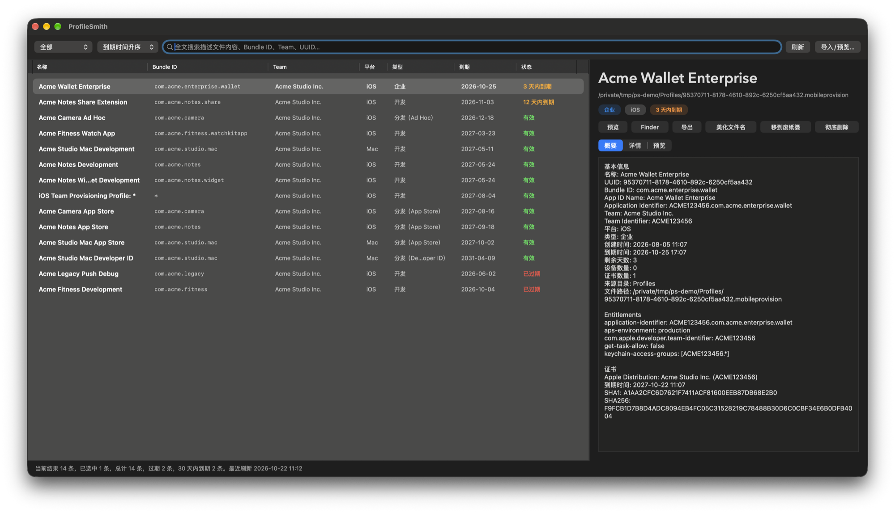

# ProfileSmith

[](https://github.com/wangwanjie/ProfileSmith/releases/latest)


ProfileSmith 是一个原生 macOS 描述文件管理器：自动索引本机所有 `.mobileprovision` / `.provisionprofile`，一眼看清哪些快过期、属于哪个 Team、绑定了哪些证书和 Entitlements，并支持导入、导出、批量清理；也可以直接预览 `.ipa`、`.xcarchive`、`.app`、`.appex` 里内嵌的描述文件。


<details>
<summary>深色模式</summary>



</details>

> 截图中的描述文件均为演示数据。

## 下载安装

前往 [Releases](https://github.com/wangwanjie/ProfileSmith/releases/latest) 下载与你的 Mac 芯片对应的安装包：

| 你的 Mac | 下载文件 |
| --- | --- |
| Apple 芯片（M1 / M2 / M3 / M4 …） | `ProfileSmith_V_<版本>_arm64.dmg` |
| Intel 芯片 | `ProfileSmith_V_<版本>_x86_64.dmg` |

不确定芯片类型时，点击屏幕左上角  →“关于本机”查看“芯片”或“处理器”一栏，或在终端执行：

```bash
uname -m
```

输出 `arm64` 选 arm64 包，输出 `x86_64` 选 x86_64 包。安装包均已通过 Developer ID 签名与 Apple 公证，打开 DMG 后把 ProfileSmith 拖进“应用程序”即可。

应用内置 Sparkle 自动更新，会根据当前 Mac 的芯片自动下载对应架构的新版本；1.4.x 及更早的通用包用户升级时也会自动切换到匹配的版本。

## 功能

- **自动索引**：扫描 `~/Library/MobileDevice/Provisioning Profiles` 与 `~/Library/Developer/Xcode/UserData/Provisioning Profiles`，SQLite + GRDB 增量索引；目录有变化时自动刷新。
- **全文搜索与筛选**：按名称、Bundle ID、Team、UUID、Entitlements 等任意内容搜索（支持子串匹配）；按即将过期、已过期、开发、分发、企业、Mac 等条件筛选，列表支持多列排序。
- **到期提醒**：状态列与菜单栏图标标出已过期、30 天内到期的描述文件。
- **详情查看**：概要、Entitlements、证书摘要（SHA1 / SHA256）和完整的原始 plist 结构树；正确识别 iOS 开发 / Ad Hoc / App Store / 企业，以及 Mac 开发 / App Store / Developer ID。
- **文件管理**：导入（拖入或 ⌘O）、导出、在 Finder 中显示、美化文件名（自动备份原文件）、移到废纸篓、彻底删除、一键清理所有过期描述文件。
- **证书导出**：在“详情”页右键证书节点，可导出为 `.cer`（DER）或 `.pem`，或复制 SHA1 / SHA256。
- **归档预览**：预览 IPA、XCArchive、App、App Extension 的 Info.plist 与内嵌描述文件。
- **Finder 集成**：在 Finder 中右键描述文件 →“打开方式 → ProfileSmith”，未导入的会自动导入，已存在的会直接定位。
- **多语言与外观**：简体中文、繁体中文、English，浅色 / 深色 / 跟随系统，均可在偏好设置中即时切换。

### 快捷键

| 操作 | 快捷键 |
| --- | --- |
| 导入描述文件 | ⌘O |
| 刷新索引 | ⌘R |
| 预览选中项 | 空格 / 双击 |
| 复制选中行 | ⌘C |
| 移到废纸篓 | Delete |
| 偏好设置 | ⌘, |

## 本地开发

要求：Xcode 26 或更新版本，macOS 12.0 及以上。主工程通过 `ProfileSmith.xcworkspace` 打开，依赖 `Vendor/` 下的 GRDB.swift、SnapKit、Sparkle 以及 CocoaPods 引入的 ViewScopeServer（仅 Debug）。

运行单元测试：

```bash
xcodebuild test -workspace ProfileSmith.xcworkspace -scheme ProfileSmith -derivedDataPath /tmp/ProfileSmithDerivedData -destination 'platform=macOS' -only-testing:ProfileSmithTests CODE_SIGNING_ALLOWED=NO
```

运行发布脚本的自测：

```bash
bash scripts/tests/main_build_entry_test.sh && bash scripts/tests/merge_appcast_test.sh
```

调试时可以用环境变量隔离真实数据：

- `PROFILESMITH_SCAN_DIRECTORIES`：替换扫描目录，多个目录用 `:` 分隔
- `PROFILESMITH_SUPPORT_DIRECTORY`：替换数据库与重命名备份所在目录

## 工程结构

- `ProfileSmith/`：主应用代码（`Data` 数据库、`Services` 解析 / 扫描 / 文件操作 / 更新、`UI` 界面、`Localization` 多语言）
- `ProfileSmithTests/`：单元测试（Swift Testing）
- `ProfileSmithUITests/`：UI 测试
- `scripts/`：DMG 打包、GitHub Release 发布、Sparkle appcast 生成脚本及其自测
- `release-notes/`：每个版本的发布说明

## 发布流程

1. 更新 `ProfileSmith.xcodeproj/project.pbxproj` 中的 `MARKETING_VERSION` 与 `CURRENT_PROJECT_VERSION`。
2. 编写 `release-notes/vX.Y.Z.md`，并同步 [CHANGELOG.md](CHANGELOG.md)。
3. 分别构建、签名、公证 arm64 与 x86_64 两个 DMG（输出到 `build/dmg/`）：

   ```bash
   ./scripts/build_dmg.sh
   ```

   只需要单个架构时可以加 `--arch arm64` 或 `--arch x86_64`。
4. 创建 GitHub Release、上传两个 DMG，并把新版本条目合并进 `appcast.xml`：

   ```bash
   ./scripts/publish_github_release.sh --notes-file release-notes/vX.Y.Z.md
   ```

5. 提交并推送 `appcast.xml`。

`appcast.xml` 中同一版本会有两个条目：arm64 条目带 `sparkle:hardwareRequirements=arm64` 且排在前面，Intel 机器会跳过它而选择 x86_64 条目，Apple 芯片机器则选择排在前面的 arm64 条目。

## 更新日志

见 [CHANGELOG.md](CHANGELOG.md)。
