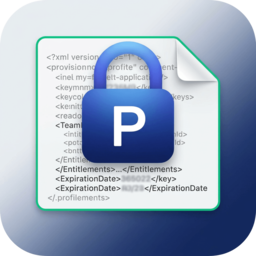
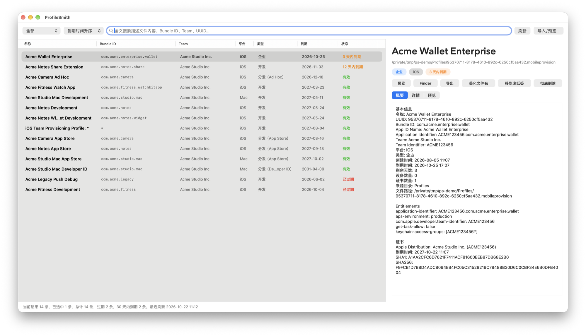

  

<h1 align="center">ProfileSmith</h1>

  原生 macOS 描述文件管理器：自动索引本机所有 <code>.mobileprovision</code> / <code>.provisionprofile</code>，一眼看清哪些快过期、属于哪个 Team、绑定了哪些证书和 Entitlements，并支持导入、导出、批量清理；也可以直接预览 <code>.ipa</code>、<code>.xcarchive</code>、<code>.app</code>、<code>.appex</code> 里内嵌的描述文件。

  <a href="https://wangwanjie.github.io/ProfileSmith/">主页</a> ·
  <a href="https://github.com/wangwanjie/ProfileSmith/releases/latest">下载</a> ·
  <a href="https://github.com/wangwanjie/ProfileSmith/issues">反馈</a>

  
  
  

深色模式

> 截图中的描述文件均为演示数据。

## 下载

ProfileSmith 为 Apple 芯片和 Intel 芯片分别提供安装包，需要 **macOS 12.0 或更高版本**。前往 [最新版本](https://github.com/wangwanjie/ProfileSmith/releases/latest) 下载与你的 Mac 芯片对应的安装包：

| 你的 Mac | 下载文件 |
| --- | --- |
| Apple 芯片（M1 / M2 / M3 / M4 …） | `ProfileSmith_V_<版本>_arm64.dmg` |
| Intel 芯片 | `ProfileSmith_V_<版本>_x86_64.dmg` |

不确定芯片类型时，点击屏幕左上角  →“关于本机”查看“芯片”或“处理器”一栏，或在终端执行 `uname -m`：输出 `arm64` 选 arm64 包，输出 `x86_64` 选 x86_64 包。历史版本见 [Releases](https://github.com/wangwanjie/ProfileSmith/releases)。

安装包均已通过 Developer ID 签名与 Apple 公证，打开 DMG 后把 ProfileSmith 拖进“应用程序”即可。

应用内置 Sparkle 自动更新，会根据当前 Mac 的芯片自动下载对应架构的新版本；1.4.x 及更早的通用包用户升级时也会自动切换到匹配的版本。

## 功能

- **自动索引**：扫描 `~/Library/MobileDevice/Provisioning Profiles` 与 `~/Library/Developer/Xcode/UserData/Provisioning Profiles`，增量索引；目录有变化时自动刷新。
- **全文搜索与筛选**：按名称、Bundle ID、Team、UUID、Entitlements 等任意内容搜索（支持子串匹配）；按即将过期、已过期、开发、分发、企业、Mac 等条件筛选，列表支持多列排序。
- **到期提醒**：状态列与菜单栏图标标出已过期、30 天内到期的描述文件。
- **详情查看**：概要、Entitlements、证书摘要（SHA1 / SHA256）和完整的原始 plist 结构树；正确识别 iOS 开发 / Ad Hoc / App Store / 企业，以及 Mac 开发 / App Store / Developer ID。
- **文件管理**：导入（拖入或 ⌘O）、导出、在 Finder 中显示、美化文件名（自动备份原文件）、移到废纸篓、彻底删除、一键清理所有过期描述文件。
- **证书导出**：在“详情”页右键证书节点，可导出为 `.cer`（DER）或 `.pem`，或复制 SHA1 / SHA256。
- **归档预览**：预览 IPA、XCArchive、App、App Extension 的 Info.plist 与内嵌描述文件。
- **Finder 集成**：在 Finder 中右键描述文件 →“打开方式 → ProfileSmith”，未导入的会自动导入，已存在的会直接定位。
- **多语言与外观**：简体中文、繁体中文、English，浅色 / 深色 / 跟随系统，均可在偏好设置中即时切换。

### 快捷键

| 操作 | 快捷键 |
| --- | --- |
| 导入描述文件 | ⌘O |
| 刷新索引 | ⌘R |
| 预览选中项 | 空格 / 双击 |
| 复制选中行 | ⌘C |
| 移到废纸篓 | Delete |
| 偏好设置 | ⌘, |

## 系统要求

- macOS 12.0 或更高版本
- Apple 芯片或 Intel 芯片的 Mac（分别下载对应安装包）

## 更新日志

见 [CHANGELOG.md](CHANGELOG.md)，每个版本的完整发布说明见 [release-notes/](release-notes/)。

## 反馈

遇到问题或有功能建议，请在 [Issues](https://github.com/wangwanjie/ProfileSmith/issues) 中提交。
